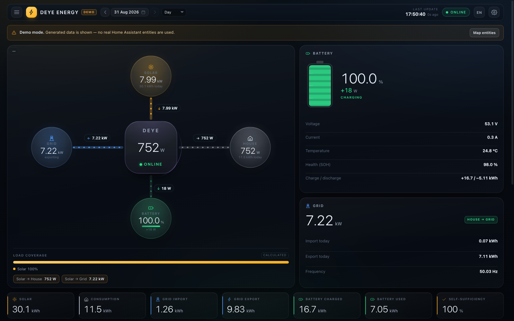
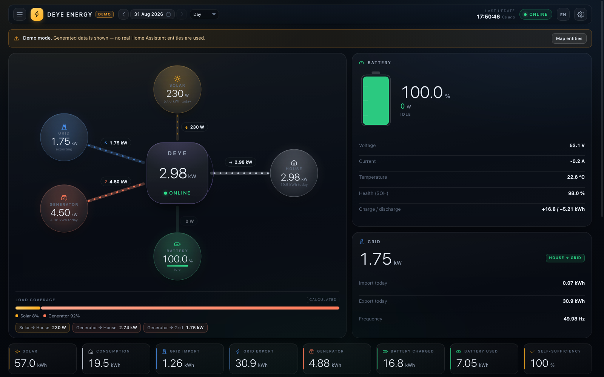
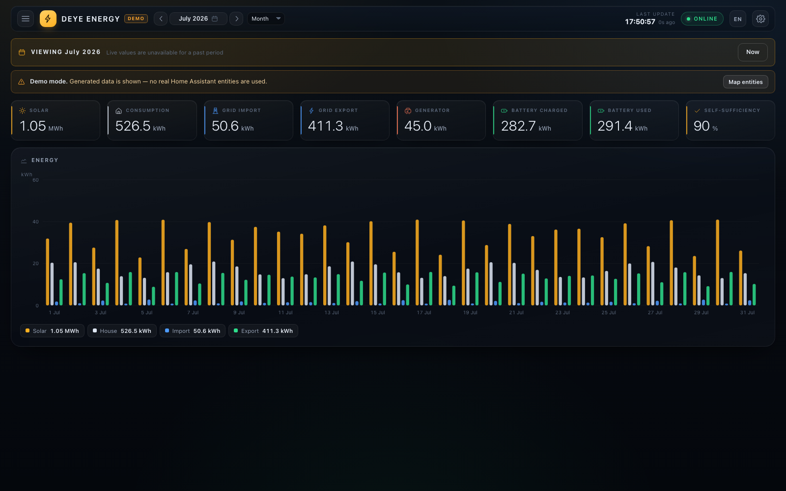
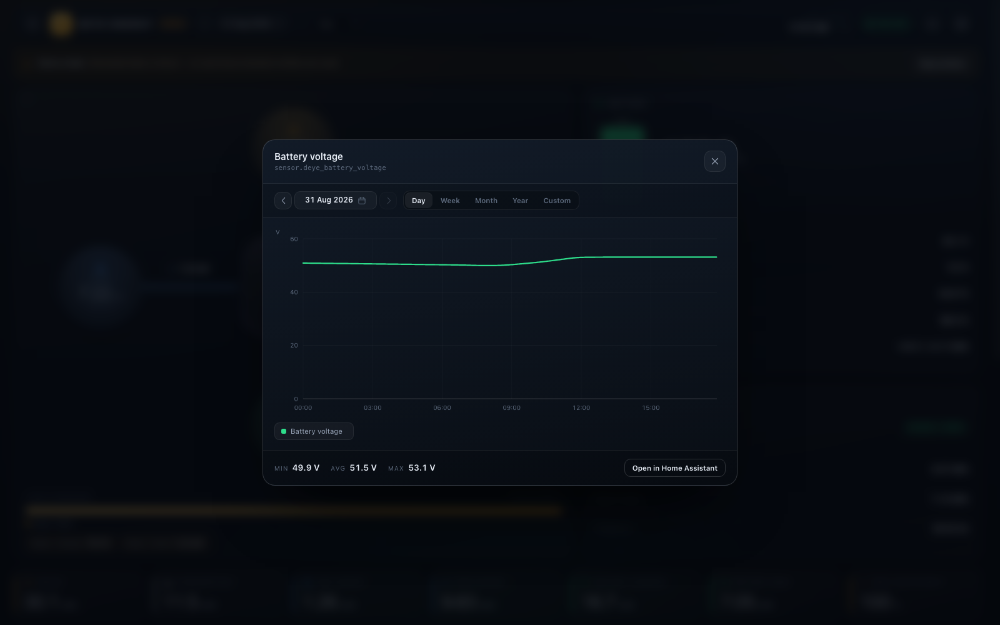
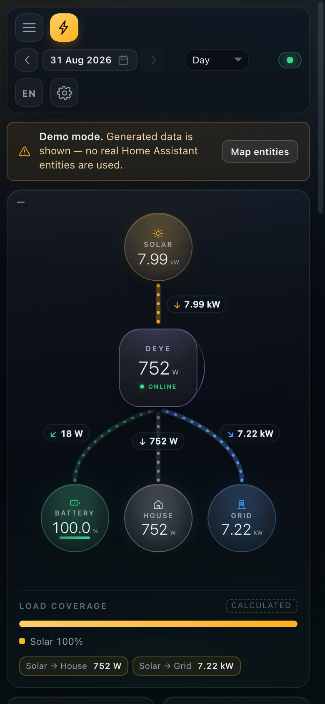
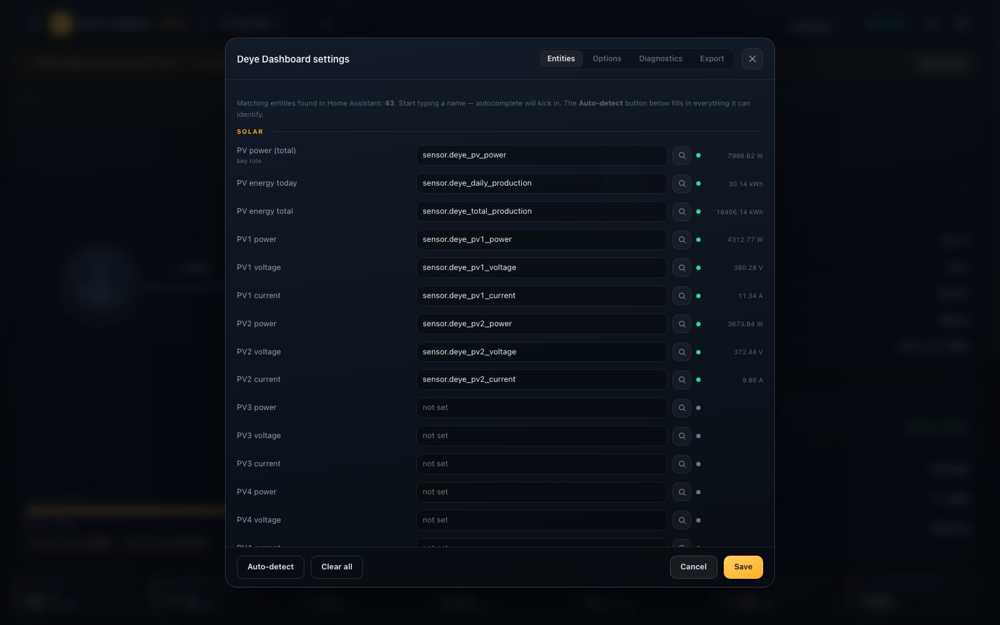

# Deye Dashboard for Home Assistant

[](https://github.com/Olexandr1904/ha_deye/actions/workflows/tests.yml)
[](https://hacs.xyz/)
[](LICENSE)

A local dashboard for a Deye hybrid inverter, as a real Home Assistant panel:
an animated energy-flow diagram, battery / grid / load / generator cards, KPI
totals for any period, and a chart you can drill into down to a single sensor.

**No clouds.** No Deye Cloud, no SolarMAN, no external API, no CDN, no separate
backend, no database of its own, no polling. The only data source is the Home
Assistant instance it runs inside.



```text
Deye inverter
     │  your local network (Modbus/MQTT, through the integration you already have)
Home Assistant entities
     │  WebSocket API — state_changed, history, statistics
Deye Dashboard  (panel_custom, vanilla JS, no iframe)
```

## What it does

| | |
|---|---|
| **Live flow** | Particles move in the direction energy actually flows, at a speed derived from the power, and stop when a link is idle. Direction comes from measured values and automatic sensor-polarity detection — not from guesswork. |
| **Any period** | Day / week / month / year or a custom interval. The choice governs the whole page: the diagram, the cards and every KPI tile. |
| **Honest history** | A period strictly in the past hides every live card instead of mixing epochs, and says which of three reasons an empty period has. |
| **Generator** | If the inverter reports one, it becomes a fifth spoke, a term in the power balance, a share of the load coverage, a KPI tile and a card — and it stays out of sight when there is nothing to show. |
| **Drill-down** | Click any value backed by an entity: its own chart, its own date navigation, min / avg / max, and a link into Home Assistant's history. |
| **Any inverter naming** | Entities are detected by unit, device class and keywords, then pinned in the UI or in YAML. Nothing is hardcoded — no entity ids, no units. |
| **Two languages** | English and Ukrainian, switchable from the header. |
| **Phones** | A separate diagram layout and a block order that follows importance. |

<table>
<tr>
<td width="50%"><br><sub>Generator running: a fifth spoke, and the export attributed to it</sub></td>
<td width="50%"><br><sub>A past month: live cards gone, totals from long-term statistics</sub></td>
</tr>
<tr>
<td><br><sub>Any value opens its own history</sub></td>
<td><br><sub>390 px: its own layout, no horizontal scrolling</sub></td>
</tr>
</table>

## Requirements

* Home Assistant 2023.4 or newer.
* A Deye (or SolarMAN-compatible) inverter already integrated — for example
  [ha-solarman](https://github.com/davidrapan/ha-solarman), Modbus, or MQTT.
  This panel reads entities; it does not talk to the inverter itself.
* For the charts: `state_class` on the energy sensors, so Home Assistant keeps
  long-term statistics for them. Everything else works without it.

## Install

### Through HACS

1. HACS → three-dot menu → **Custom repositories** → add
   `https://github.com/Olexandr1904/ha_deye`, category **Dashboard**.
2. Find **Deye Dashboard** in HACS and download it.
3. Add the panel (below) and restart Home Assistant.

HACS puts the files in `/config/www/community/ha_deye/`, served as
`/hacsfiles/ha_deye/`.

```yaml
# configuration.yaml — or better, packages/deye_dashboard.yaml
panel_custom:
  - name: deye-dashboard          # must match the custom element name
    sidebar_title: Deye
    sidebar_icon: mdi:solar-power-variant
    url_path: deye-dashboard
    module_url: /hacsfiles/ha_deye/ha_deye.js?v=1.2.1
    embed_iframe: false           # no iframe: the panel lives inside HA
    require_admin: false
```

### By hand

Copy the contents of [`dist/`](dist/) into `/config/www/deye-dashboard/`, then use
the same `panel_custom` block with
`module_url: /local/deye-dashboard/ha_deye.js?v=1.2.1`.

There is also `tools/deploy.py`, which copies the files over SMB (the Samba share
add-on), writes the panel package, and stamps every import with the version so a
cached module cannot survive an update. See [tools/README.md](tools/README.md).

### Ask an AI to do it

If you keep an assistant with access to your Home Assistant files, paste this:

```text
Install the Deye Dashboard panel in my Home Assistant.

1. Download https://github.com/Olexandr1904/ha_deye and copy everything from its
   dist/ directory into /config/www/deye-dashboard/ (create the directory).
2. Create /config/packages/deye_dashboard.yaml with:

   panel_custom:
     - name: deye-dashboard
       sidebar_title: Deye
       sidebar_icon: mdi:solar-power-variant
       url_path: deye-dashboard
       module_url: /local/deye-dashboard/ha_deye.js?v=1.2.1
       embed_iframe: false
       require_admin: false

   Make sure configuration.yaml has `homeassistant: packages: !include_dir_named packages`
   (add it if missing, do not remove anything else).
3. Validate the configuration, then restart Home Assistant.
4. Tell me the entity ids of my inverter's PV power, battery SOC, battery power,
   grid power and load power, so I can check the panel picked the right ones.

The panel needs no internet access, no API key and no integration of its own.
```

Then open **Deye** in the sidebar. The first run detects your entities; the gear
icon lets you correct anything it got wrong.

## Configuration

Everything is optional — the panel works with what it detects. Priority:
defaults → `config:` in YAML → the gear icon (stored in the browser).

```yaml
    config:
      language: auto              # auto | en | uk
      ratedPowerKw: 12
      batteryCapacityKwh: 11.7    # omit it and the value comes from an entity
      powerDirection:
        battery: auto             # auto | charge_positive | discharge_positive
        grid: auto                # auto | import_positive | export_positive
      entities:
        pvPower: sensor.inverter_pv_power
        batterySoc: sensor.inverter_battery
        batteryPower: sensor.inverter_battery_power
        gridPower: sensor.inverter_grid_power
        loadPower: sensor.inverter_load_power
```

The gear icon → **Export** generates a ready-made block for your own system.
The full list of roles, with the keywords used to detect them, is in
[`deye-dashboard/js/config.js`](deye-dashboard/js/config.js).



## Try it without an inverter

`dist/index.html?demo=1` runs the whole panel against a simulated inverter — a
solar curve, a house profile, a battery, and a generator that runs in the
evening. Every screenshot above is that demo. `?hour=20` pins the time of day.

## Documentation

| | |
|---|---|
| [docs/INSTALL.md](docs/INSTALL.md) | installation in detail, checking the signs, troubleshooting |
| [docs/ARCHITECTURE.md](docs/ARCHITECTURE.md) | how it is built, module by module, and why |
| [docs/test-plan.md](docs/test-plan.md) | what is guaranteed, how it is checked, and what is not covered |
| [tools/README.md](tools/README.md) | the test suites and the deployment script |
| [CONTRIBUTING.md](CONTRIBUTING.md) | how to run the tests and what a change needs |

## Tests

```bash
./tools/run-tests.sh
```

217 unit assertions (calendar arithmetic, energy distribution, history windowing,
chart axes, stored-config migration, the deployment YAML — no browser, under a
second) and then 183 checks in a real headless Chrome over the DevTools Protocol.
No npm dependencies: Node 22+, python3 and Chrome.

There is also `tools/test-in-ha.mjs` — 42 assertions inside a running Home
Assistant against a real inverter, including every KPI tile for a past day
checked against the inverter's own daily counter.

## Deliberately absent

Lovelace card stacks; an iframe with Deye Cloud; a separate backend or database;
calls to cloud servers and analytics; sensor polling; a frontend framework; an
external charting library; hardcoded entity ids and units.

## Licence

[MIT](LICENSE). Not affiliated with Deye or SolarMAN.
